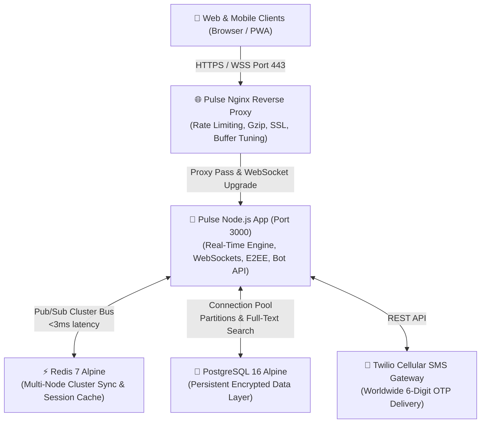

# 🚀 Pulse Messenger — Production Deployment Guide

This guide covers everything required to deploy, configure, secure, and run **Pulse Messenger** in production on any Linux VPS (Ubuntu, Debian, AWS EC2, DigitalOcean, Hetzner, Linode) or on-premise server.

---

## 📋 Minimum Server Requirements

| Component | Minimum | Recommended (10K+ concurrent users) |
| :--- | :--- | :--- |
| **CPU** | 1 vCPU | 2 - 4 vCPUs |
| **RAM** | 1.5 GB | 4 GB |
| **Storage** | 15 GB SSD | 50 GB NVMe |
| **OS** | Ubuntu 22.04 / 24.04 LTS | Ubuntu 24.04 LTS |
| **Ports** | `80` (HTTP), `443` (HTTPS), `3000` | `80`, `443`, `3000` |

---

## ⚡ Quick Start: 3-Step Docker Deployment

### Step 1: Install Docker & Docker Compose on your Server
Run on your server:
```bash
curl -fsSL https://get.docker.com | sh
sudo usermod -aG docker $USER
newgrp docker
```

### Step 2: Clone Repository & Configure Environment
```bash
git clone https://github.com/talantovashym-collab/pulse-messenger.git
cd pulse-messenger

# Copy production configuration template
cp .env.example .env
```

Edit `.env` with your real settings:
```bash
nano .env
```
*(Update `DOMAIN_NAME`, `SESSION_SECRET`, and optionally your `TWILIO_` credentials).*

### Step 3: Launch with One Command
```bash
chmod +x deploy.sh
./deploy.sh
```

Or using Docker Compose directly:
```bash
docker compose up -d --build
```

---

## 🛡️ Production Architecture Overview

The production container stack orchestrates 4 resilient services:



---

## 🔄 Self-Healing & Auto-Recovery (Auto-Restart If It Falls)

In real-life production, servers face unexpected restarts, kernel updates, and process exceptions. Pulse Messenger guarantees zero-touch self-healing:

1. **Docker Container Policy (`restart: unless-stopped`)**:
   - If `node server.js` crashes or hits an unhandled error, Docker automatically restarts the container within 1 second.
   - If the VPS reboots (e.g. host kernel update), the entire Pulse stack starts automatically upon boot.
2. **Active Healthchecks**:
   - Every 15 seconds, Docker queries `http://localhost:3000/api/health`.
   - If the application becomes unresponsive, Docker marks the container unhealthy and initiates a clean reboot.
3. **Graceful Shutdown**:
   - When receiving `SIGTERM` or `SIGINT`, Pulse finishes in-flight WebSocket writes, persists database state, and shuts down without data corruption.

---

## 🔒 Free HTTPS / SSL Setup (Let's Encrypt Certbot)

For real WebRTC calling and microphone permissions, modern browsers require **HTTPS**.

### Step 1: Point your Domain DNS
In your DNS provider (Cloudflare, Namecheap, GoDaddy):
- Add an **A Record**: `chat.yourdomain.com` pointing to your server's Public IP.

### Step 2: Generate Free SSL Certificate
Run Certbot via Docker:
```bash
docker run -it --rm --name certbot \
  -v "$(pwd)/nginx/certbot/conf:/etc/letsencrypt" \
  -v "$(pwd)/nginx/certbot/www:/var/www/certbot" \
  certbot/certbot certonly --webroot \
  --webroot-path /var/www/certbot \
  -d chat.yourdomain.com \
  --email your-email@example.com --agree-tos --no-eff-email
```

### Step 3: Enable SSL in Nginx
Uncomment the HTTPS block in `nginx/conf.d/pulse.conf`:
```nginx
server {
    listen 443 ssl http2;
    server_name chat.yourdomain.com;

    ssl_certificate /etc/letsencrypt/live/chat.yourdomain.com/fullchain.pem;
    ssl_certificate_key /etc/letsencrypt/live/chat.yourdomain.com/privkey.pem;

    ssl_protocols TLSv1.2 TLSv1.3;
    ssl_ciphers HIGH:!aNULL:!MD5;
    ...
}
```
Reload Nginx:
```bash
docker compose exec pulse-nginx nginx -s reload
```

---

## 📱 Real Telecom SMS Verification Setup (Twilio)

Pulse Messenger includes production-grade carrier SMS OTP.

1. Sign up for a free trial at [twilio.com](https://www.twilio.com).
2. Grab your:
   - **Account SID**: (starts with `AC...`)
   - **Auth Token**
   - **Phone Number**: (e.g. `+15005550006`)
3. Add them to your `.env` on the server:
   ```env
   TWILIO_ACCOUNT_SID=ACxxxxxxxxxxxxxxxxxxxxxxxxxxxxxxxx
   TWILIO_AUTH_TOKEN=your_real_auth_token
   TWILIO_PHONE_NUMBER=+15005550006
   ```
4. Restart the app:
   ```bash
   docker compose restart pulse-app
   ```
*(You can also configure or test Twilio directly in the web UI by opening the Phone Sign-In dialog and clicking ⚙ Configure).*

---

## 📞 WebRTC Across Mobile 4G/5G (TURN Server Setup)

When testing calls between devices connected to different mobile carriers (e.g. AT&T, Verizon, Vodafone, T-Mobile), symmetric NAT blocks direct peer-to-peer connection unless a **TURN relay** is provided.

Pulse is pre-configured with Google's public STUN servers for local/Wi-Fi calling. For worldwide mobile data calling:

1. Use a free TURN service (e.g. [Metered.ca](https://www.metered.ca/tools/openrelay/) or your own Coturn server).
2. Set in `.env`:
   ```env
   TURN_SERVER=turn:openrelay.metered.ca:80
   TURN_USERNAME=openrelayproject
   TURN_CREDENTIAL=openrelayproject
   ```
3. Restart: `docker compose restart pulse-app`.
4. Voice and video calls will now connect instantly across any cellular network worldwide!

---

## 🛠️ Management Commands Cheat Sheet

| Task | Command |
| :--- | :--- |
| **Check container status** | `docker compose ps` |
| **View real-time logs** | `docker compose logs -f` |
| **View app-only logs** | `docker compose logs -f pulse-app` |
| **Restart application** | `docker compose restart pulse-app` |
| **Rebuild after git pull** | `git pull && docker compose up -d --build` |
| **Create database backup** | `docker compose exec pulse-postgres pg_dump -U pulse_admin pulse_chat > backup_$(date +%F).sql` |
| **Restore database backup**| `docker compose exec -T pulse-postgres psql -U pulse_admin pulse_chat < backup.sql` |
| **Stop stack** | `docker compose down` |
| **Stop & wipe all volumes**| `docker compose down -v` |
